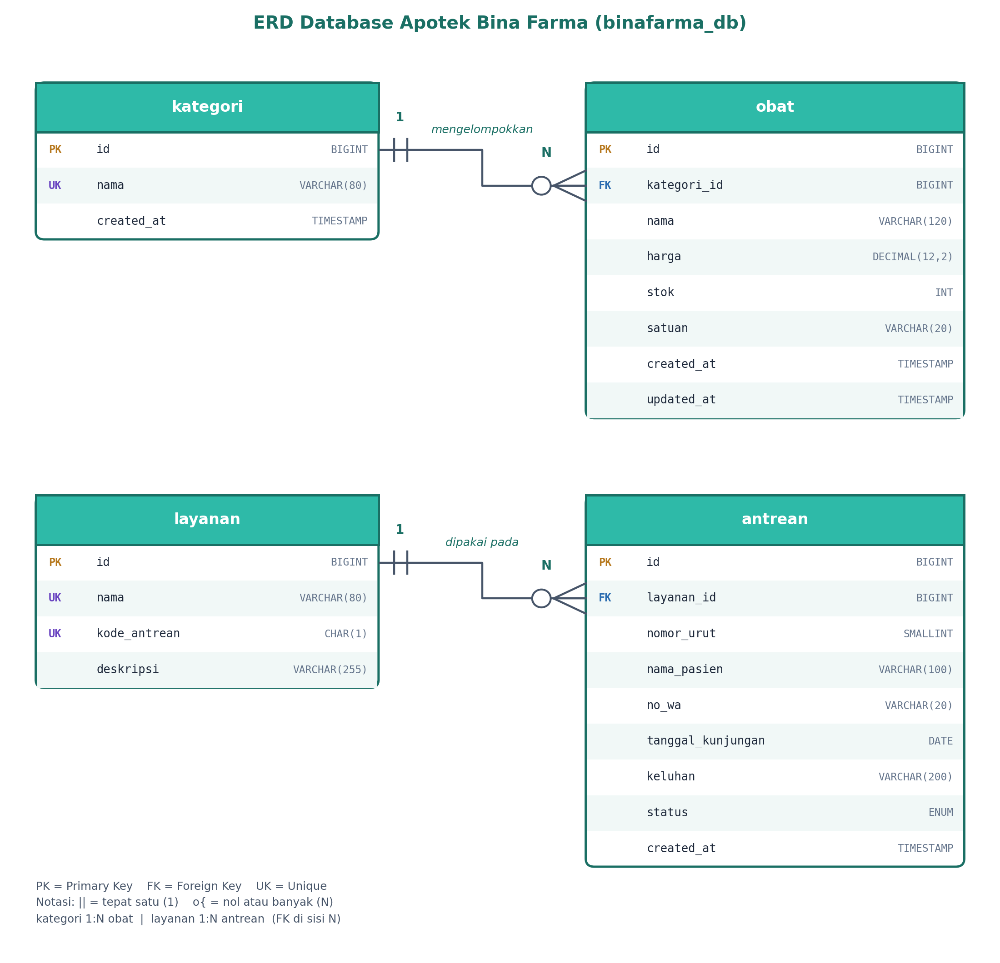
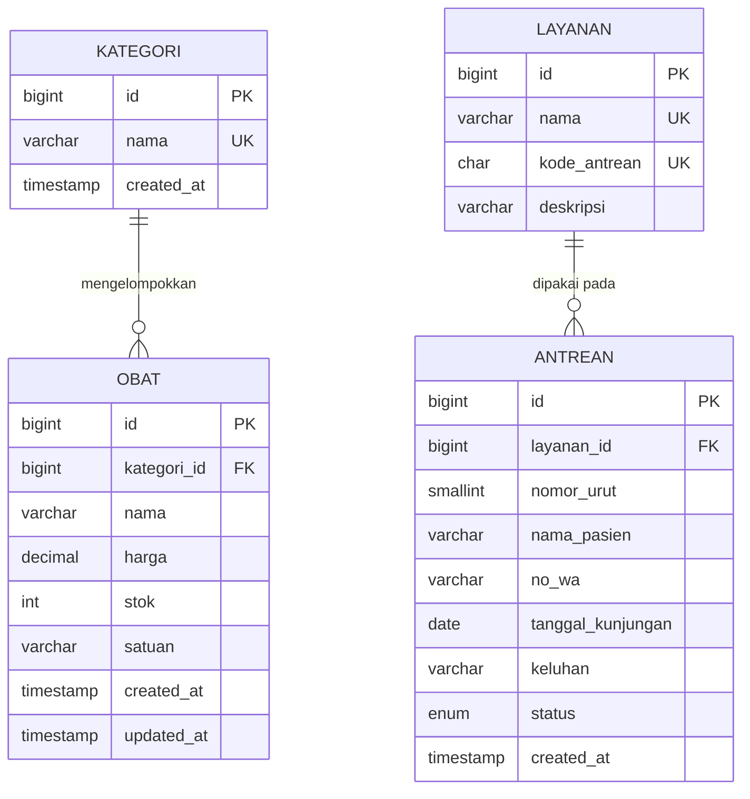

# ERD dan Data Dictionary — Database Apotek Bina Farma

Database: `binafarma_db` (MySQL/MariaDB, Laragon)

## Data dictionary

### kategori
| Kolom | Tipe | Constraint | Keterangan |
| --- | --- | --- | --- |
| id | BIGINT UNSIGNED | PK, AUTO_INCREMENT | identitas kategori |
| nama | VARCHAR(80) | NOT NULL, UNIQUE | Obat Bebas, Resep Dokter, Skincare, dst. |
| created_at | TIMESTAMP | DEFAULT CURRENT_TIMESTAMP | waktu dibuat |

### obat
| Kolom | Tipe | Constraint | Keterangan |
| --- | --- | --- | --- |
| id | BIGINT UNSIGNED | PK, AUTO_INCREMENT | identitas obat |
| kategori_id | BIGINT UNSIGNED | FK → kategori.id, NOT NULL | kategori obat |
| nama | VARCHAR(120) | NOT NULL, INDEX | nama obat |
| harga | DECIMAL(12,2) | NOT NULL, CHECK >= 0 | harga satuan (rupiah) |
| stok | INT UNSIGNED | NOT NULL, DEFAULT 0 | jumlah stok |
| satuan | VARCHAR(20) | NOT NULL, DEFAULT 'unit' | strip, botol, box, dst. |
| created_at | TIMESTAMP | DEFAULT CURRENT_TIMESTAMP | waktu dibuat |
| updated_at | TIMESTAMP | ON UPDATE CURRENT_TIMESTAMP | waktu diubah terakhir |

### layanan
| Kolom | Tipe | Constraint | Keterangan |
| --- | --- | --- | --- |
| id | BIGINT UNSIGNED | PK, AUTO_INCREMENT | identitas layanan |
| nama | VARCHAR(80) | NOT NULL, UNIQUE | Konsultasi Dokter, Pemeriksaan GCU, dst. |
| kode_antrean | CHAR(1) | NOT NULL, UNIQUE | huruf awal nomor antrean (A → A-014) |
| deskripsi | VARCHAR(255) | NULL | penjelasan singkat layanan |

### antrean
| Kolom | Tipe | Constraint | Keterangan |
| --- | --- | --- | --- |
| id | BIGINT UNSIGNED | PK, AUTO_INCREMENT | identitas antrean |
| layanan_id | BIGINT UNSIGNED | FK → layanan.id, NOT NULL | layanan yang dipilih |
| nomor_urut | SMALLINT UNSIGNED | NOT NULL | urutan per layanan per hari |
| nama_pasien | VARCHAR(100) | NOT NULL | nama pendaftar |
| no_wa | VARCHAR(20) | NOT NULL | nomor WhatsApp |
| tanggal_kunjungan | DATE | NOT NULL | tanggal kunjungan |
| keluhan | VARCHAR(200) | NULL | keluhan singkat (opsional) |
| status | ENUM('Menunggu','Dilayani','Selesai','Dibatalkan') | NOT NULL, DEFAULT 'Menunggu' | status antrean |
| created_at | TIMESTAMP | DEFAULT CURRENT_TIMESTAMP | waktu mendaftar |

Constraint tambahan: `UNIQUE (layanan_id, tanggal_kunjungan, nomor_urut)` mencegah nomor antrean ganda.

## Keputusan desain

- **Normalisasi.** Kategori dan layanan dipisah menjadi tabel sendiri supaya nama tidak diulang di setiap baris obat atau antrean.
- **Atribut turunan tidak disimpan.** `ketersediaan` dihitung dari `stok > 0`, dan nomor antrean `A-014` dirakit dari `kode_antrean` + `nomor_urut`, jadi tidak ada risiko data tidak sinkron.
- **Foreign key `ON DELETE RESTRICT`.** Kategori atau layanan tidak bisa dihapus selama masih dipakai.
- **Index.** `idx_obat_nama` untuk pengurutan dan pencarian awalan nama. `idx_antrean_tanggal_status` untuk query ringkasan antrean per tanggal. Kolom FK otomatis ter-index. `LIKE '%kata%'` tidak bisa memakai index biasa, jadi untuk data besar perlu FULLTEXT.
- **Data sensitif.** Nama, WA, dan keluhan pasien tidak diekspos lewat endpoint publik. Tabel `users` dan autentikasi direncanakan di Modul 12.